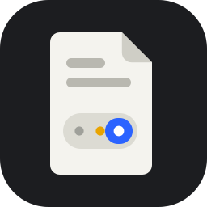

<p align="center"></p>

<p align="center">
<a href="https://github.com/smith89k/laravel-post-mcp/actions/workflows/tests.yml"></a>
<a href="https://packagist.org/packages/smith89k/laravel-post-mcp"></a>
<a href="https://packagist.org/packages/smith89k/laravel-post-mcp"></a>
<a href="https://github.com/smith89k/laravel-post-mcp/blob/main/LICENSE.md"></a>
</p>

# Laravel Post MCP

Let an AI app (Claude, ChatGPT, Cursor and others) write and manage the blog posts of your Laravel site, using the **Post model you already have**.

`smith89k/laravel-post-mcp` adds a [Model Context Protocol](https://modelcontextprotocol.io) server to your app with [`laravel/mcp`](https://github.com/laravel/mcp). Your AI app connects to one URL, signs in with OAuth, and can then list, read, draft, edit, schedule and publish posts, and upload images. It does this with your own model, events, validation rules and storage. The package creates no blog tables.

- **Adapts to your model.** It reads your table columns, `$fillable`/`$guarded`/`$hidden`, `$casts`, enums, relationships and FormRequest rules, and builds the tool schemas from them.
- **Saves like your admin does.** Posts are saved through Eloquent, so your model events and observers run. You can also bind your own writer class.
- **Safe by default.** Every call checks a gate that denies everyone until you define it. Requests are rate limited. Every change is written to an audit log. Only the configured model is reachable, and there is no hard delete unless you turn it on.

## Requirements

- PHP 8.2+
- Laravel 12.41+ or 13 (the minimum set by `laravel/mcp` 1.3)
- [Laravel Passport](https://laravel.com/docs/passport) 13 for OAuth mode (needed by apps that sign in, such as Claude and ChatGPT)

## Install in 3 steps

**1. Require the package**

```bash
composer require smith89k/laravel-post-mcp
```

**2. Run the installer**

```bash
php artisan post-mcp:install
```

The installer:

- asks which model holds your posts
- detects the title, slug, body, status, publish date, relations and images
- prints the **field map**
- writes `config/post-mcp.php` and publishes the audit log migration
- checks your Passport setup and tells you exactly what is missing
- prints your connector URL

**3. Allow yourself, then connect your AI app**

Define who may use the tools, for example in `AppServiceProvider::boot()`:

```php
use Illuminate\Support\Facades\Gate;

Gate::define('use-post-mcp', fn ($user) => $user->is_admin);
```

Then add the connector URL in your AI app (see [Connecting an AI app](#connecting-an-ai-app)).

### OAuth setup (if the installer reports it missing)

```bash
composer require laravel/passport
php artisan vendor:publish --tag=passport-migrations
php artisan migrate
php artisan passport:keys
```

- Add `Laravel\Passport\HasApiTokens` and `implements Laravel\Passport\Contracts\OAuthenticatable` to your `User` model.
- Add an `api` guard to `config/auth.php`: `'api' => ['driver' => 'passport', 'provider' => 'users']`.
- If your site has no route named `login` (for example when you only use the Filament login), set `POST_MCP_LOGIN_URL=/admin/login`. Passport sends signed-out users there before showing the consent screen.

Run `php artisan post-mcp:install` again at any time to re-check.

## The tools

| Tool | What it does |
|---|---|
| `get_post_fields` | The field map: types, required fields, allowed values, live tag/category/relation values from the database, statuses, slug rules, content format |
| `list_posts` | Filter by status, search text, relation value, publish date range; paginated |
| `get_post` | One post by id or slug, with status and public URL |
| `create_post` | Creates a **draft**; publishes only with `publish: true`, schedules with `publish: true` + future `publish_at` |
| `update_post` | Partial update of writable fields only; never changes the status or the slug unless sent |
| `publish_post` / `unpublish_post` / `schedule_post` | Status changes (`schedule_post` only when you have a publish date column) |
| `upload_image` | From a public URL or base64, through your media driver; returns the URL and Markdown/HTML snippets, and can set a featured image |
| `delete_post` | Only when `delete.enabled` is true; needs `confirm: true` |

When validation fails, the tool answers with a readable list (`- slug: The slug has already been taken.`), so the AI app can fix the input and try again.

Check what the AI app will see at any time:

```bash
php artisan post-mcp:fields          # table
php artisan post-mcp:fields --json   # full map
```

## Connecting an AI app

Your connector URL is `APP_URL` + `route.path`, for example `https://example.com/laravel-post-mcp`. It speaks MCP over Streamable HTTP, so any app that supports remote MCP servers can use it. AI apps only connect to HTTPS URLs that are reachable from the internet.

The settings page and the consent screen call each app by the name it registers with, so you see "What ChatGPT can do with your posts" when ChatGPT is the one connected.

Tested end to end with Claude. Other apps follow the same OAuth steps, but their menus change often: look for "custom connector", "MCP server" or "add a tool by URL".

### Chat apps (Claude, ChatGPT and others)

1. In the app's settings, add a custom connector (MCP server) and paste the connector URL.
2. Connect. The app opens your site, you sign in, and you approve access on the consent screen.

In Claude this is **Settings → Connectors → Add custom connector**; connectors added on claude.ai also work in Claude Desktop. On team plans an owner may need to add the connector for the organization first.

### Editors (Cursor, VS Code and others)

Add an HTTP MCP server to the editor's `mcp.json`, for example in Cursor (`~/.cursor/mcp.json`):

```json
{ "mcpServers": { "posts": { "url": "https://example.com/laravel-post-mcp" } } }
```

or in VS Code (`.vscode/mcp.json`):

```json
{ "servers": { "posts": { "type": "http", "url": "https://example.com/laravel-post-mcp" } } }
```

The editor opens your site to sign in. Desktop apps return from sign-in to their own kind of address (`cursor://`, `vscode://`); `auth.app_schemes` lists the ones allowed.

### Claude Code

```bash
claude mcp add --transport http posts https://example.com/laravel-post-mcp
# then run /mcp inside Claude Code to sign in
```

### Apps that cannot sign in

Use a fixed access key (set `POST_MCP_AUTH=token`):

```bash
php artisan passport:client --personal                    # once
php artisan post-mcp:token you@example.com --name="My app" # prints the key
```

Give the app the connector URL and the header `Authorization: Bearer <key>`. The `--name` is what the settings page shows. If your app uses Sanctum, set `POST_MCP_GUARD=sanctum` and `post-mcp:token` creates a Sanctum token instead.

## Settings page

Site owners who don't edit code can open `APP_URL/laravel-post-mcp/settings` (or the connector URL in a browser) and choose, by clicking:

- for each field: **Hidden**, **Can read** or **Can edit**
- a friendlier name and a short note that tells the AI app how to fill the field in
- for each relation: whether the AI app can add new items (for example new tags)

Changes apply on the next request, with no cache to clear and nothing to deploy. The page is self-contained (no Vite, Tailwind or outside fonts), follows light and dark mode, and works without JavaScript.

It works **inside** the limits of `config/post-mcp.php`: it can switch things off and back on, never open what the config keeps closed. Secret-looking columns stay hidden, the title, slug, content, status and date fields can't be hidden, and relations missing from `relations` can't be switched on. Each locked switch says why on the page.

Who can open it: signed-in users the `use-post-mcp` gate allows (`ui.middleware` defaults to `web` and `auth`). Choices are stored in the `post_mcp_settings` table, so run `php artisan migrate` after updating. Until the table exists, the connector uses the config alone and the page asks for the migration. Turn the page off with `ui.enabled => false`.

## Configuration reference

All settings live in `config/post-mcp.php` (publish with `php artisan vendor:publish --tag=post-mcp-config`).

| Key | Default | Meaning |
|---|---|---|
| `model` | `App\Models\Post` | The Eloquent model the tools manage |
| `server.name` / `server.instructions` | app name + " Posts" / built-in | What the AI app sees when it connects |
| `route.path` | `laravel-post-mcp` | Connector path (`POST_MCP_PATH`) |
| `route.middleware` | `[]` | Extra middleware after authentication |
| `route.rate_limit` | `60` | Requests per minute per user; `null` turns it off |
| `ui.enabled` / `ui.path` | `true` / `laravel-post-mcp/settings` | The settings page and its path (`POST_MCP_UI_PATH`) |
| `ui.middleware` / `ui.table` | `['web', 'auth']` / `post_mcp_settings` | Middleware before the gate check; table for the page's choices |
| `auth.mode` | `oauth` | `oauth` (Passport) or `token` (`POST_MCP_AUTH`) |
| `auth.guard` | `api` | Guard used to authenticate requests |
| `auth.gate` | `use-post-mcp` | Ability checked on every call; undefined = everyone denied |
| `auth.oauth_registration` / `auth.oauth_rate_limit` | `true` / `10` | Dynamic client registration and its per-minute limit |
| `auth.login_url` | `null` | Adds a `login` route redirecting here, for sites without one |
| `auth.app_schemes` | claude, cursor, vscode, vscode-insiders, windsurf | Return-address schemes desktop apps may register besides https and localhost |
| `auth.register_authorization_view` | `true` | Use the package's consent screen for Passport (a `mcp.authorize` view in your app wins) |
| `fields.discovery` | `auto` | `auto` or `explicit` (only `fields.only` + role columns) |
| `fields.except` | `[]` | Columns never exposed |
| `fields.overrides` | `[]` | Per field: `label`, `description`, `type`, `required`, `enum`, `rules`, `hidden`, `read_only` |
| `fields.cache_ttl` | `3600` | Seconds the field map is cached; `0` = no cache |
| `title_column` | `title` | Title column |
| `author_column` | `null` | Filled with the signed-in user's id on create |
| `status.mode` | `column` | `boolean` (a true/false flag) or `column` (string or backed enum) |
| `status.column` / `status.values` | `status` / draft, published, scheduled | Column and the values for each status (`scheduled` may be `null`) |
| `status.published_at` | `published_at` | Publish date column, or `null` (no scheduling) |
| `status.clear_date_on_unpublish` | `false` | Clear the publish date when unpublishing |
| `slug.column` / `slug.strategy` | `slug` / `from_title` | `from_title`, `model` (your model fills it) or `none` |
| `slug.reserved` | `[]` | Slugs that clash with your routes |
| `content.column` / `content.format` | `body` / `html` | `html`, `markdown` or `blocks` |
| `content.input_format` / `content.converter` | `null` | Let the AI app write one format and store another (e.g. `MarkdownToHtmlConverter`) |
| `validation.create` / `validation.update` | `null` | Your FormRequest classes; their rules and messages are applied |
| `relations` | `[]` | Writable relations: `label` column, `creatable`, `rules` for new labels, `description`, and `details` the AI app fills in on new items (text, lists, images by URL) |
| `media.driver` | `none` | `none`, `disk`, `medialibrary` or a class implementing `MediaDriver` |
| `media.disk` / `media.directory` | `public` / `posts` | Where the disk driver stores images |
| `media.collection` | `images` | Media library collection |
| `media.attach_to` / `media.attach_value` | `null` / `path` | Featured image column (or collection) and whether it stores the path or URL |
| `media.max_kb` / `media.mimes` / `media.timeout` | `5120` / jpg, jpeg, png, gif, webp / `15` | Upload limits |
| `writer` | `null` | A class implementing `PostWriter` |
| `public_url.route` | `null` | Named route that takes the post, for links |
| `list.per_page` / `list.max_per_page` / `list.search` / `list.order_by` | `15` / `50` / `[title]` / publish date | Listing |
| `delete.enabled` | `false` | Offer `delete_post` |
| `audit.enabled` / `audit.table` / `audit.log_channel` | `true` / `post_mcp_audit_logs` / `null` | Audit log |

### Field rules

- The primary key, timestamps, generated columns and guarded columns are **read-only**.
- `$hidden` columns and anything that looks like a secret (`password`, `*_token`, `secret`, `api_key`...) are **never exposed**, even with an override.
- The status, publish date and author columns are managed by the package and change only through the status tools.
- Only relations listed in `relations` are readable or writable. `belongsTo` and `belongsToMany` can be set.
- With `details`, the AI app can finish a related item while writing the post, for example a new project with its description, links and logo. New items get every detail sent. Existing items get their empty details filled in, and list details (such as links) get new entries added; nothing already written is changed or removed. Any list can grow this way: described lists (`each`) are matched by their first part (the address), and lists nobody described get their entry shape from items already saved, so new entries may only use the parts saved ones have. Turn growing off per list with `grow => false`, or with the "Can add more to existing ones" switch on the settings page. Every item is checked before anything is saved. Only columns that exist, are fillable and are not secret, hidden, keys or timestamps can be details.

### Saving through your own services

```php
use Smith89k\PostMcp\Contracts\PostWriter;

class PostServiceWriter implements PostWriter
{
    public function __construct(private PostService $posts) {}

    public function create(array $attributes, array $relations): Model { return $this->posts->create($attributes, $relations); }
    public function update(Model $post, array $attributes, array $relations): Model { return $this->posts->update($post, $attributes, $relations); }
    public function delete(Model $post): void { $this->posts->delete($post); }
}
```

Set `'writer' => PostServiceWriter::class`, or bind `PostWriter` in a service provider.

### A custom media driver

Implement `Smith89k\PostMcp\Contracts\MediaDriver::store(ImageFile $image, ?Model $post): StoredImage` and set `media.driver` to the class name. The image has already passed the type and size checks.

## Security notes

- **Authentication:** OAuth 2.1 with PKCE through Passport, or a bearer token. The MCP route has no session and no CSRF exposure.
- **Authorization:** the gate is checked on every tool call, and everyone is denied until you define it. Use your existing admin check.
- **Scope:** tools only touch the configured model and the relations you list. There is no generic query or SQL tool.
- **Rate limiting:** per user on the MCP route, and per IP on OAuth client registration.
- **Audit log:** every create, update, publish, unpublish, schedule, upload and delete is stored with the user, the tool, the post and the changed fields. Set `audit.log_channel` to also send it to a log.
- **Uploads:** the real file type is checked (SVG is not allowed). URL fetches refuse private, loopback, link-local and reserved addresses, including on redirects, and connect to the address that was checked.
- **Deleting** is off by default and needs `confirm: true` when on.
- **Dynamic client registration** is public by design (RFC 7591). It is rate limited; set `auth.oauth_registration` to `false` and create clients by hand if you prefer.

## FAQ

**Does it create a posts table?** No. It only adds the audit log table (and Passport's tables if you did not have them).

**My status is a boolean `is_published` plus a `published_at` date.** Use `status.mode = boolean`. A published post with a future date counts as scheduled.

**My slug is made by a package or a model hook.** Use `slug.strategy = model`. The package then never fills it.

**The AI app keeps sending the wrong field.** Run `php artisan post-mcp:fields` and add `description`, `enum` or `rules` overrides. They flow straight into the tool schemas.

**I changed the config and the AI app still sees old fields.** The field map is cached for `fields.cache_ttl` seconds. `php artisan post-mcp:fields` rebuilds it.

**The AI app says it cannot connect.** The URL must be public HTTPS, and `/.well-known/oauth-protected-resource` and `/.well-known/oauth-authorization-server` must be reachable. Check that Passport keys exist on the server and that `APP_URL` is your real https URL.

**A client gets "Forbidden: The request origin is not allowed."** `laravel/mcp` rejects browser `Origin` headers that are not your `APP_URL`. Publish its config (`php artisan vendor:publish --tag=mcp-config`) and add the origin to `allowed_origins`.

**The consent screen fails with "Vite manifest not found".** laravel/mcp's consent view loads `resources/css/app.css` through Vite. Run `npm run build`, or publish the view (`php artisan vendor:publish --tag=mcp-views`) and change the `@vite` line to fit your assets.

**Can I use it without Passport?** Yes, in token mode with Sanctum or a custom guard. Apps that sign in themselves (Claude, ChatGPT) need OAuth, though.

## Testing

```bash
composer test      # PHPUnit + Orchestra Testbench
composer analyse   # Larastan level 6
composer format    # Pint
```

The suite runs against three fixture models: a simple post (title/body/status), a rich post (author, category, tags, SEO fields, featured image, scheduling, FormRequests) and an unusual post (different column names, a custom key, an enum status and Markdown).

You can also try the server with the MCP Inspector:

```bash
npx @modelcontextprotocol/inspector
# Transport: Streamable HTTP, URL: https://your-site.test/laravel-post-mcp
```

## License

MIT. See [LICENSE.md](LICENSE.md).
